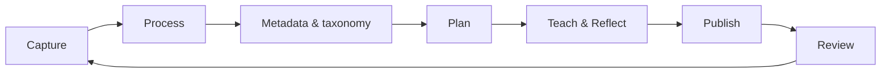

# Teacher's Knowledge Management Workflow: From Classroom Notes to a Living Knowledge Base

## Abstract

Most teachers already practise personal knowledge management (PKM), but without a system. Material piles up in slide decks, shared drives, exam-board folders and private notebooks. It is organised by the curriculum of the year, and it rarely gets better from one year to the next. This article describes a workflow that apply idea of digital garden, where knowledge thrive and grow over time.  

The loop runs from capture, to curriculum-neutral concept notes, to prerequisite links, to curriculum alignment, to lessons planned as paths through the concept graph, to teaching and reflection, and finally to selective publication as a public digital garden. Two ideas hold it together. First, **concepts come first and curricula second**, so one body of knowledge can serve several programmes at once. Second, **every stage of the loop leaves a trace in plain, versioned files**, so the knowledge base improves with every lesson taught and stays readable by people, scripts and AI agents. The workflow is presented as a set of stages and principles, not as a particular software stack. It ends with a proposed pilot study.

*Companion articles: "From Teacher's Notes to a Professional Digital Garden" (publishing private notes as a professional learning network) and "Concepts First, Curricula Second: A Teacher's Knowledge Graph" (the data model). This article joins the two into a single working practice.*

## 1. Why a workflow and not just a tool

Teachers work with knowledge all the time: 
- a clearer explanation, 
- an analogy or metaphor that worked, 
- a misconception that keeps coming up, 
- an exercise that finally made recursion click.

Most of it is lost, for three reasons.

1. **It is stored by time/files, not by concepts.** 
*Knowledge lives inside "Grade 9 – Term 2 – Week 4.pptx". To find it again you have to remember when teacher taught it, not what it was about.*
2. **It is tied to one curriculum.** 
*When the programme changes (a new exam board, a new national standard, a new school), the material is copied, partly rewritten, and drifts away from the original.*
3. **Reflection is not recorded.** 
*What happened in the lesson stays in the teacher's head. Next year's preparation starts from the same plan, not from an improved one.*

Research on PKM and personal learning environments emphasises learner-controlled systems that combine formal and informal learning [3, 6]. 
Work on professional learning networks shows the value of sharing beyond the institution [4]. 

What these strands usually lack is a concrete, repeatable *practice* that a working teacher can keep up during a school year. 
Simply installing a note-taking app does not supply that practice, but a workflow might help.

## 2. Design principles

The workflow is built on six principles.

1. **Concepts first, curricula second.** The stable unit of knowledge is a single teachable idea. A curriculum is a selection and ordering of those ideas, mapped to external codes.
2. **Atomic and linked.** One idea per note, with explicit links to the ideas it depends on. Value comes from the connections, not from the size of the collection [5].
3. **Plain, open formats.** The knowledge base stays readable without the application that created it, and so does the AI agent's view of it.
4. **Versioned and auditable.** Every change is recorded and can be undone. The history of how a concept explanation changed is itself professional evidence.
5. **Private by default, public by choice.** Nothing is published unless it is explicitly marked for publication.
6. **Repeatable.** The whole setup runs on any major consumer operating system with free, open-source software, so another can reproduce it on his//her computer with his/her OS, PKM tool,  mange it with AI or his/her choice.

### **Markdown as the foundation.** 
In order to follow principles above markdown with structured frontmatter suites it's best purpose.
It allows linking notes, it is plain and open format, that easily can be veriotioned 


Every note is a plain-text Markdown file with structured YAML frontmatter. The format matters more than any tool, for several reasons:
    - *Longevity and ownership.* Markdown is plain text. It opens in any editor on any operating system and will still be readable decades from now. No vendor, licence or subscription stands between the teacher and their material.
    - *Readable as written.* A Markdown note is readable before it is rendered, so the source file *is* the document. There is no export step and nothing gets lost in conversion.
    - *Portable across tools.* The same files work in Obsidian, VS Code, Logseq, Typora or a basic text editor, and can be turned into websites, PDFs, slides (Marp, reveal.js) or Word documents (Pandoc). The teacher can change tools without migrating content.
    - *Structure that machines can use.* Frontmatter (`requires`, `evidence`, `standards`) turns notes into data. Scripts can build coverage reports and prerequisite graphs without a database.
    - *Native to AI agents.* Large language models read and write Markdown fluently. An agent can work directly on the files in a folder, with no API, plugin or export in between, and every change it makes shows up as a clear text diff.
    - *Friendly to version control.* Plain text gives clean, line-by-line histories in git (principle 4). Binary formats such as .docx or .pptx do not.
    - *Rich enough for teaching.* Headings, lists, tables, code blocks, math (LaTeX), diagrams (Mermaid), images and links cover nearly everything a concept note needs.


## 3. The workflow

The workflow is a loop of seven stages.
A single concept may pass through it many times over the years, and each pass leaves the knowledge base better than before.



### 3.1 Capture: get it out of your head fast

Inputs come from everywhere: 
- a conference talk, 
- a textbook chapter, 
- a student question, 
- a programme document,
- a video, 
- an idea on the way home. 
The only rule at this stage is **low friction**. Material goes into a note as quick, rough notes, clippings or pasted images, without any attempt to organise it.
Raw notes never get published.

### 3.2 Process: turn notes into concepts

Regularly notes revised and processes. 
Processing helps either merge note into an existing concept note or becomes a new concept. 
A concept note:
- explains **one** idea well enough to teach it,
- does **not** mention a grade, term or exam board,
- holds the explanation, history, examples, analogies and known misconceptions,
- states **evidence of mastery**: observable things a student can do once they understand the idea.
- has link to at least one existing concept
At this stage is where most of the professional thinking happens. 
Rewriting a textbook definition in your own words, for your own students, is a form of reflective practice: finding better illustration or diagrams or examples.

*Output:* curriculum-neutral concept notes 

### 3.3 Metadata and taxonomy: connect concepts and align them to curricula

Each concept note carries its metadata in frontmatter. 
Frontmatter is a block of structured metadata placed at the very top of a text or Markdown file

The metadata does two jobs: it places the concept in the subject's prerequisite graph, and it maps the concept to the curricula the teacher works with.

```yaml
requires:
  - concept: "[[Sequence]]"
    strength: hard          # cannot be understood without it
    reason: "An algorithm is an ordered sequence of steps"
  - concept: "[[Boolean data]]"
    strength: soft          # helps, but can be taught in parallel
    reason: "Selection uses Boolean conditions"
standards:
  - cambridge-igcse-cs:7.1
  - ap-csp:AAP-2
  - school-k12:G6.ALG.1
```

**Connect.** Every concept records the concepts it **requires**, and the knowledge base can derive which concepts it **unlocks**. Each dependency has a strength and a short reason. Ordinary in-text links ("see also") are kept for loose associations. Typed `requires` links are kept for prerequisites. The result is a directed graph of the teacher's subject, the same structure that open efforts such as Marble's skill taxonomy publish at dataset scale [1, 2].

**Align.** Each programme the teacher works with (a national standard, Cambridge, AP, an internal K-12 framework) gets one **programme note** that lists the programme's own structure and codes. The concept's `standards:` field points to those codes. The alignment is many-to-many. One concept can satisfy several programmes, and one programme objective can need several concepts. From these fields a coverage report can be generated for every programme: objectives fully covered, partly covered, or missing. *Complying* with a new curriculum then becomes a mapping exercise followed by gap-filling, not a rewrite.

*Output:* a prerequisite graph, programme notes, and per-programme coverage.

### 3.4 Plan: lessons are paths through the graph

A lesson or unit does **not** re-explain concepts. It links to them. Planning means:

1. choosing the target concepts for the unit (usually from a programme's objectives),
2. pulling in their unmet prerequisites,
3. ordering everything along the prerequisite edges,
4. adding what only the lesson knows: the age group, timing, activities, resources and assessment.

Because the same concept node is linked from Grade 3 and Grade 10 lessons, the concept page shows, through its backlinks, how the idea spirals through the school. Designing a *new* curriculum uses the same operation at a larger scale: choose a target set and order the subgraph.

*Output:* lesson and unit notes that link concepts to a particular class and date.

### 3.5 Teach & Reflect: close the loop

After the lesson, a short reflection is added to the lesson note: what worked, what confused students, which questions came up, how long things actually took. The workflow then requires one step that most planning systems leave out: **push what you learned back into the concepts.**

- A new misconception goes into the concept note.
- A better analogy replaces the old one.
- A prerequisite the students lacked becomes a new `requires` edge, or a soft edge becomes a hard one.
- Evidence-of-mastery criteria are sharpened according to what students could and could not do.

This step turns a pile of lesson plans into knowledge that accumulates. The lesson record is tied to one date. The concept improves for every future class and every curriculum.

*Output:* updated concepts and edges, and a dated reflection log.

### 3.6 Publish: share the concepts, not the paperwork

Notes that are ready and appropriate, mostly concepts and resources, are marked for publication with a single frontmatter flag. A build step turns them into a static website, a **digital garden** [5, 7]. Internal links become hyperlinks, backlinks are generated, and the site is searchable. Student data, drafts, feedback templates and administrative documents stay private by default.

Concept notes are curriculum-neutral, so a published concept is useful to teachers on *any* programme. A published unit plan is rarely as reusable. Publishing in public also adds a gentle quality pressure, and it turns a private PKM system into a visible node in a professional learning network [4].

*Output:* a public site that grows and changes; it is never "finished".

### 3.7 Review: tend the garden

Once a term, the teacher looks after the knowledge base as a whole:

- clear the inbox, merge duplicate concepts, split notes that grew too large,
- find orphan concepts (nothing links to them) and concepts that no lesson uses,
- re-run coverage for each active programme,
- check for cycles or missing edges in the prerequisite graph.

*Output:* a healthy graph and a short "state of the garden" note, which can also serve as material for an annual teaching report.

## 4. Where AI agents fit

Because everything is plain text with structured fields, AI agents can help at almost every stage. The teacher remains the editor and makes the final decision.

| Stage | Useful agent tasks | Teacher keeps |
| --- | --- | --- |
| Capture | Transcribe recordings, summarise long documents, clip sources | Choosing what is worth keeping |
| Process | Draft a concept note from sources, suggest misconceptions | The explanation and voice |
| Metadata & taxonomy | Propose prerequisite edges with reasons, detect cycles, match programme objectives to concepts, draft coverage reports | Accepting edges and the final alignment judgement |
| Plan | Order a concept set along prerequisites, draft activities | Pedagogy and pacing |
| Reflect | Turn rough post-lesson notes into concept updates | What actually happened in class |
| Review | Find duplicates, orphans and broken links | Restructuring decisions |

Open formats matter here. An agent that can read and edit Markdown files in a folder works with any tool. An agent locked inside one vendor's platform does not.

## 5. A reference implementation

The workflow does not depend on any specific software. As one concrete example, the author's setup is:

- **Writing and linking:** Obsidian, a Markdown editor with wikilinks, backlinks and templates. Any editor that handles Markdown folders would work.
- **Versioning:** each knowledge base (for example one per subject) is a git repository.
- **Publishing:** a small static-site build (Eleventy) that copies only notes flagged `garden: true`, resolves wikilinks, generates backlinks, renders math (MathJax), highlights code, and indexes the site for in-browser search (Pagefind). The output is hosted as static files.
- **Rendering rules:** runtime-only plugin features (such as Dataview queries) are not published. What gets published is what is in the files.

Every part of this list can be replaced. The workflow keeps working as long as the six principles in section 2 hold.

## 6. Proposed pilot study

The workflow has not yet been tested with a group of teachers. A mixed-methods longitudinal pilot of one or two semesters is proposed.

**Research questions**

1. How does the workflow, and especially the *reflect → update concept* step, influence teachers' reflective practice?
2. Does a concept-first structure reduce duplicated preparation for teachers who work with more than one curriculum?
3. To what extent does publishing a digital garden encourage knowledge sharing and collaboration among teachers?
4. What barriers and enablers (time, technical confidence, school policy) affect adoption?

**Design**

- *Phase 1 – Baseline:* participants describe their current PKM, planning and sharing practices, and estimate their planning time.
- *Phase 2 – Intervention:* a short training, then a semester of using the workflow with a provided template knowledge base.
- *Phase 3 – Analysis:* pre/post surveys (technology self-efficacy, reflective practice, perceptions of sharing), graph metrics over time (concepts, edges, aligned objectives, concept revisions after lessons), planning-time logs, and semi-structured interviews.

*Results: to be collected and reported in a follow-up article.*

## 7. Limitations

- **Upfront cost.** Distilling and connecting take time before they pay off. The benefit grows with the size of the graph and the number of curricula it serves.
- **Granularity is subjective.** What counts as one concept differs between teachers, which makes it hard to merge graphs.
- **Alignment is not learning.** A `standards:` tag shows that material addresses an objective, not that students reached it.
- **Prerequisites are hypotheses.** Edges come from experience and should be checked against student outcomes.
- **Privacy discipline.** A single knowledge base holds both public concepts and private student-related notes. The publish filter must be strict and opt-in.
- **Markdown is not mainstream among teachers.** Plain-text note-taking is still a minority practice, concentrated in technical and higher-education settings [8].

## 8. Conclusion

The goal is not a better note-taking app but a better practice. When knowledge is captured quickly, distilled into curriculum-neutral concepts, connected by explicit prerequisites, aligned to whatever programmes the school requires, planned as paths, improved after every lesson, and shared in public, teaching material stops being something rebuilt every year. It becomes a body of professional knowledge that grows over time. The tools in section 5 are one way to run this loop. The loop itself is the contribution.

## References

[1] Zendot, "Marble Open-Sources a Skill Taxonomy of 1,590 Elementary Learning Topics Wired by Prerequisites," 19 Oct 2026. https://www.zendot.org/en/posts/withmarbleapp-os-taxonomy
[2] Marble, *os-taxonomy*. https://github.com/withmarbleapp/os-taxonomy
[3] N. Dabbagh and A. Kitsantas, "Personal Learning Environments, social media, and self-regulated learning: A natural formula for connecting formal and informal learning," *The Internet and Higher Education*, vol. 15, no. 1, pp. 3–8, 2012.
[4] T. Trust, D. G. Krutka, and J. P. Carpenter, "'Together we are better': Professional learning networks for teachers," *Computers & Education*, vol. 102, pp. 15–34, 2016.
[5] M. Appleton, "A Brief History & Ethos of the Digital Garden." https://maggieappleton.com/garden-history
[6] S. Whittaker, "Personal Information Management: From Information Consumption to Curation," *Annual Review of Information Science and Technology*, vol. 45, 2011.
[7] M. Bohuslavová, "Cultivating ideas: exploring digital gardening as a tool of personal information management in communities of practice," 2024. https://magdalenabohuslavova.wordpress.com/2024/08/27/cultivating-ideas-exploring-digital-gardening-as-a-tool-of-personal-information-management-in-communities-of-practice-mbib4250-1-essay/
[8] "R Markdown as a dynamic interface for teaching: Modules from math and biology classrooms." https://pmc.ncbi.nlm.nih.gov/articles/PMC9487201/
