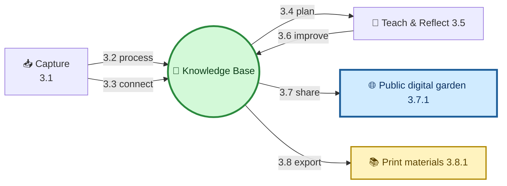

---
keywords:
  - personal knowledge management
  - digital garden
  - concept notes
  - prerequisite graph
  - curriculum alignment
  - reflective practice
  - local-first software
  - open formats
subtitle: From simple notes to a living Knowledge Base
---

# Teacher's Knowledge Management Workflow

## Abstract

Many teachers already practice personal knowledge management (PKM), but without a system. Material piles up in slide decks, shared drives, exam-board folders and private notebooks. It is organised by the curriculum of the year, and it rarely gets better from one year to the next. This article describes a workflow that applies the idea of a digital garden, where knowledge grows over time.

The workflow is built around a **garden** of curriculum-neutral concept notes linked by prerequisites. Captured material is processed into concepts and connected to them, then aligned to the curricula the teacher uses. Lessons are planned as paths through this concept graph. After teaching, reflection is used to improve the concepts, so each pass leaves the garden better than before. From the garden, selected notes are published as a public digital garden and exported as teaching materials, course guides and reports. The workflow rests on two ideas.
First, **concepts come first and curricula second**, so one body of knowledge can serve several study programs at once.
Second, **every change to the knowledge base leaves a trace in plain, versioned files**, so the knowledge base improves with every update and stays readable by people and by software, including AI agents.
The files live on the teacher's own computer first (a **local-first** approach): the cloud is used for backup, sync and publishing, but never holds the only copy.

The author uses Obsidian to read and edit the notes, but the workflow is not limited to it. Any text editor that can read and edit the notes will work, and AI agents can read and update them too.
Paper notes have to be digitised to become part of the knowledge base.
Recordings can be used, but they also need to be transcribed into text.
Curricula, syllabuses and lesson plans can be compiled into web pages or PDFs for sharing and printing, but the workflow itself works on digital notes.

The workflow is presented as a set of stages and principles, not as a particular software stack. It ends with a proposed pilot study.

## Who this is for

This article will not hand over a finished course. It does not supply ready-made lesson plans, worksheets, or a study program a school can adopt and teach as it stands. It is not written for a well-established school that is content with the program it already runs and only needs materials to deliver that program. Those needs are already met by curriculum publishers and lesson-plan libraries.

It is for people who have to build the program, or who have been given one and want to go beyond it:

- **Developing schools and private schools** that are still writing, adapting, or replacing their own study program, and cannot treat a publisher's course as the whole of what they teach.
- **Homeschooling communities** that share teaching across families and need a body of knowledge they can keep, reuse, and improve together.
- **Any teacher** who has been handed a syllabus and wants to own the ideas underneath it: understand them, teach them, revise them after class, and use the same knowledge with more than one program.

It is also for people who want to **keep** what they build. The knowledge base is ordinary files on the teacher's own computer. It works offline. It does not depend on a school account, a subscription, a vendor's servers, or proprietary software. If the teacher changes school or editor, the notes stay readable and stay theirs.

## 1. Why a workflow and not just a tool or product

Teachers work with knowledge all the time:
- a clearer explanation,
- an analogy or metaphor that worked,
- a misconception that keeps coming up,
- an exercise that finally made recursion click.

Most of it is lost, for three reasons.

1. **It is stored by files, not by concepts.**
*Knowledge lives inside "Grade 9 – Term 2 – Week 4.pptx". To find it again you have to remember when you taught it, not what it was about.*
2. **It is tied to one curriculum.**
*When the study program changes (a new exam board, a new national standard, a new school), the material is copied, partly rewritten, and drifts away from the original.*
3. **Reflection is not recorded.**
*What happened in the lesson stays in the teacher's head. Next year's preparation starts from the same plan, not from an improved one.*

Research on personal learning environments emphasises learner-controlled systems that combine formal and informal learning [3]. Research on personal information management describes how people keep, organise and reuse information as a personal resource, which Whittaker calls curation [6].
Work on professional learning networks shows the value of sharing beyond the institution [4].

This research rarely offers a concrete, repeatable *practice* that a working teacher can keep up during a school year.
Installing a note-taking app does not provide one; a workflow might.

The idea of a digital garden is decades old. It goes back to the hypertext of the early 1990s and was taken up again in 2015, when Mike Caufield contrasted the garden with the stream of a blog or social feed [5].


## 2. Design principles

The workflow is built on seven principles.

1. **Concepts first, curricula second.** The stable unit of knowledge is a single teachable idea. A curriculum is a selection and ordering of those ideas, mapped to external codes.
2. **Atomic and linked.** One idea or lesson per note, with explicit links to the concepts it depends on. As in a digital garden, notes are organised by the links between them rather than by date [5].
3. **Plain, open formats.** The knowledge base stays readable without the application that created it, and so does the AI agent's view of it.
4. **Versioned and auditable.** Every change is recorded and can be undone. The history of how a concept explanation changed is itself professional evidence.
5. **Local first.** The knowledge base lives as ordinary files on the teacher's own device. It works offline, opens instantly, and does not depend on a school account, a vendor's servers or a subscription. Sync, backup and publishing are layered on top, but the local copy is the source of truth, and the teacher keeps it when they change school or tool [9].
6. **Private by default, public by choice.** Nothing is published unless it is explicitly marked for publication.
7. **Repeatable.** The whole setup runs on any major consumer operating system with free, open-source software, so anyone can reproduce it on their own computer, with their own operating system and PKM tool, and manage it with the AI tool of their choice.

### Markdown as the foundation

To follow these principles, every note is a plain-text Markdown file with structured YAML frontmatter. Markdown supports links between notes, it is a plain and open format, and it is easy to keep under version control. The format matters more than any tool, for several reasons:

- *Longevity and ownership.* Markdown is plain text. It opens in any editor on any operating system and will still be readable decades from now. No vendor, licence or subscription stands between the teacher and their material.
- *Readable as written.* A Markdown note is readable before it is rendered, so the source file is the document. There is no export step and nothing gets lost in conversion.
- *Portable across tools.* The same files work in Obsidian, VS Code, Logseq, Typora or a basic text editor, and can be turned into websites, PDFs, slides (Marp, reveal.js) or Word documents (Pandoc). The teacher can change tools without migrating content.
- *Structure that machines can use.* Frontmatter (`requires`, `evidence`, `standards`) turns notes into data. Scripts can build coverage reports and prerequisite graphs without a database.
- *Readable by AI agents.* Language models handle Markdown well. An agent can work directly on the files in a folder, with no API, plugin or export in between, and every change it makes shows up as a text diff.
- *Friendly to version control.* Plain text gives clean, line-by-line histories in git unlike binary formats such as .docx or .pptx (principle 4).
- *Rich enough for teaching.* Headings, lists, tables, code blocks, math (LaTeX), diagrams (Mermaid), images and links cover nearly everything a concept note needs.


## 3. The workflow

The workflow is built around one centre: the **garden** of concept notes and the links between them.
Everything else either feeds the garden, draws from it, or takes care of it.

A single concept may go through the loop many times over the years.



### 3.1 Capture

Inputs come from everywhere:
- a conference talk,
- a textbook chapter,
- a student question,
- a study program document,
- a video,
- an idea on the way home.

> [!important]
> The only rule at this stage is **low friction**.

Material goes into a note as:
- draft text notes,
- screenshots,
- audio notes,
- video clip

with little attempt to organise it.

> [!important]
> Raw notes never get published.

### 3.2 Process

Notes are revised and processed regularly.
Processing either merges a note into an existing concept note or turns it into a new concept.
A concept note:
- explains **one** idea well enough to teach it,
- does **not** mention a grade, term or exam board,
- holds the explanation, history, examples, analogies or known misconceptions,
- states **evidence of mastery**: observable things a student can do once they understand the idea,
- links to at least one existing concept.

Rewriting a textbook definition in your own words, for your own students, is a form of reflective practice: finding a better illustration, diagram or example.


> [!important]
> This is the stage where most of the professional thinking happens.


### 3.3 Connect

At this stage the teacher connects concepts and aligns them to curricula.

Each concept note carries its metadata in frontmatter.

> [!info]
> Frontmatter is a block of structured metadata placed at the very top of a Markdown file.

The metadata does two jobs: it places the concept in the subject's prerequisite graph, and it maps the concept to the curricula the teacher works with.

```yaml
requires:
  - concept: "[[Sequence]]"
    strength: hard          # cannot be understood without it
    reason: "An algorithm is an ordered sequence of steps"
  - concept: "[[Boolean data]]"
    strength: soft          # helps, but can be taught in parallel
    reason: "Selection uses Boolean conditions"
standards:
  - cambridge-igcse-cs:7.1
  - ap-csp:AAP-2
  - school-k12:G6.ALG.1
```

**Connect.** Every concept records the concepts it **requires**, and the knowledge base can derive which concepts it **unlocks**. Each dependency has a strength and a short reason. Ordinary in-text links ("see also") are kept for loose associations. Typed `requires` links are kept for prerequisites. The result is a directed graph of the teacher's subject. Marble's open skill taxonomy has the same structure: 1,590 elementary learning topics linked by prerequisites [1, 2]. Chen et al. built such a graph for school mathematics automatically, taking concepts from the curriculum standards and prerequisite edges from student test data [13]. Here the edges are written by the teacher, each with a reason, and student data can be used to check them (section 7).

**Align.** Each study program the teacher works with (a national standard, IB, Cambridge, AP, an internal K-12 framework) gets one **study program note** that lists the program's own structure and codes. The concept's `standards:` field points to those codes.
The alignment is many-to-many. One concept can satisfy several programs, and one program objective can need several concepts.
From these fields a coverage report can be generated for every study program: objectives fully covered, partly covered, or missing.
*Complying* with a new curriculum then becomes a mapping exercise followed by filling the gaps, instead of a rewrite.


> [!important]
> AI can help here, especially once the knowledge graph exists. The work does not need a fast model: it can run overnight on a slow local one.


### 3.4 Plan: lessons are paths through the graph

A lesson or unit does **not** re-explain concepts. It links to them. Planning means:

1. choosing the target concepts for the unit (usually from a study program's objectives),
2. pulling in their unmet prerequisites,
3. ordering everything along the prerequisite edges,
4. adding what only the lesson knows: the age group, timing, activities, resources and assessment.

Because the same concept note is linked from Grade 3 and Grade 10 lessons, its backlinks show how the idea comes back at higher levels across the school. Designing a *new* curriculum uses the same operation at a larger scale: choose a target set and order the subgraph.

A university course has used the same structure. For an online master's course in geo-information science, teachers at the University of Twente turned the course textbook into a "Living Textbook": one entry per concept, kept as a searchable wiki and shown as a concept map. The relations between concepts were agreed by the teachers of each topic in discussion sessions. Students and teachers could use *learning paths*, which the authors define as a sequence of concepts read one after the other to cover a subject [14]. Grades were compared with the previous year's on-campus edition, which also used different software and teaching, so they cannot be credited to the textbook. The design is the useful part: a whole course was run on linked concepts and paths through them.


### 3.5 Teach & Reflect

After the lesson, a short reflection is added to the lesson note: what worked, what confused students, which questions came up, how long things actually took. The workflow then requires one step that most planning systems leave out: **push what you learned back into the concepts.**

- A new misconception goes into the concept note.
- A better analogy replaces the old one.
- A prerequisite the students lacked becomes a new `requires` edge, or a soft edge becomes a hard one.
- Evidence-of-mastery criteria are sharpened according to what students could and could not do.

The lesson record stays tied to one date, while the concept note carries the change into later classes.


### 3.6 Improve: help the concepts grow

Reflection only matters if it changes something. In this stage the teacher goes back to the concept notes and edits them, so the next lesson starts from an improved version.

Improvements are small and frequent rather than big rewrites:
- add a misconception or a student question that came up in class,
- replace an explanation, example or diagram with one that worked better,
- add, remove or strengthen a `requires` edge,
- sharpen the evidence of mastery,
- split a note that tries to explain two ideas, or merge two notes that explain the same one.

Digital gardens describe how mature a note is with simple growth stages [5]. The same idea works well for concept notes, kept as one field in the frontmatter:

```yaml
status: seedling   # seedling → budding → evergreen
```

- **Seedling:** a first draft, just processed from captured notes.
- **Budding:** taught at least once and revised after reflection.
- **Evergreen:** taught several times, stable, and clear enough for another teacher to use.

A note moves up a stage only after it has been taught and improved, so the status shows how much classroom evidence lies behind it. Seedlings can still be published if their status is visible.

Because the knowledge base is versioned (principle 4), every improvement is recorded. The history of a concept note shows how the teacher's understanding of how to teach the idea has changed over the years. That history is itself evidence of professional growth.

> [!important]
> Improve the concept, not the lesson plan. A lesson note records one class on one date. A concept note serves every future class and every curriculum.

Once a term, the teacher also looks after the knowledge base as a whole:

- clear the inbox, merge duplicate concepts, split notes that grew too large,
- find orphan concepts (nothing links to them) and concepts that no lesson uses,
- re-run coverage for each active study program,
- check for cycles or missing edges in the prerequisite graph.


### 3.7 Share

Notes that are ready and appropriate, mostly concepts and resources, are marked for publication with a single frontmatter flag. A build step turns them into a static website, a **digital garden** [5, 7]. Student data, drafts, feedback templates and administrative documents stay private by default.

A concept note does not name a grade or exam board, so a published concept is useful to teachers on any study program. A published unit plan is rarely as reusable. Publishing also makes the teacher write more carefully, and it makes their work visible to teachers outside the school, the kind of sharing that professional learning networks rely on [4].

#### 3.7.1 Public digital garden

A digital garden is a collection of pages arranged by topic instead of by date, as a blog is. Its notes are linked to each other, they are revised in public for years, and some of them are openly unfinished [5]. A reader can enter at any note and follow the links. Appleton describes the ethos as *learning in public*: a note can be shared while it is still a seedling, as long as the reader can see that it is one [5]. Bohuslavová describes the same practice as a tool of personal information management that a community of practice can draw on [7].

The Living Textbook described in 3.4 looks like a garden from outside: one page per concept, a concept map, and paths through it [14]. It was built differently. It started from a finished textbook, its links were agreed by a team of teachers for one course, and it runs as a tool hosted by the institution. The paper does not describe how its entries change after teaching. A garden grows the other way: from one teacher's notes, revised after each lesson, and kept as files the teacher owns. The same course's exercise materials were closer to that: plain-text sources, built into web pages, ePub and PDF, with an offline copy for students with poor connections.

Most of what a garden needs comes from the earlier stages. Concept notes are atomic and linked, the `requires` edges show which concept comes before which, growth stages show how mature a note is, and reflection keeps the notes changing. The garden needs no separate writing: when a concept improves after a lesson, its public page improves at the next build.

Sharing copies a note; the original stays in the vault. The choice is one field in the frontmatter, `garden: true`. A note without that field is private (principle 6). Raw captures, drafts, lesson reflections, student names, feedback and school paperwork are left unmarked, so they never leave the machine. A concept note is marked when the teacher is confident in the explanation. Unit plans are tied to one class and are rarely worth publishing.

The flag is checked in one place, the step that selects notes for the build, so there is only one answer to "is this note public?". Images and other files go with the notes that use them. A screenshot attached only to a private note stays private.

A digital garden is built with a static site generator (SSG): a program that turns a folder of text files into a folder of web pages. The result is linked HTML pages, with CSS and images, in the same folder structure as the notes.

The reader's browser only downloads those files. No program runs on the server, and there is no database, account system or admin panel. For a teacher this means:

- cheap or free hosting, because static files can be served by almost any web host;
- little to maintain or attack, because there is no server code or database to update;
- fast pages, because each page is generated in advance and opens quickly even on a slow school network;
- easy moving, because the output is a folder of files, and changing host means copying it.

An SSG cannot show anything that is computed live inside the editor. An Obsidian Base or a Dataview query is a working view for the teacher (3.9). A reader of the site sees the notes and the links that were written in the files.

The generator runs on the teacher's own computer, where the vault lives, so publishing is local first as well [9]:

- the site can be built and previewed on the laptop with no network; only uploading an update needs a connection;
- the host only holds generated pages, so if it closes or deletes the site, nothing is lost: the teacher builds again and uploads somewhere else;
- the notes are plain Markdown and the output is plain HTML, so the generator, the editor and the host can each be replaced on its own (section 5);
- the vault is under version control, so every published state of the garden can be traced to a commit and rebuilt.

Each build can also be checked. The teacher, a script, or an agent can list links that lead nowhere, notes that were published by mistake, and files that were copied without a note that uses them.

### 3.8 Export: turn the garden into documents

School administration, parents and students still need ordinary documents:
- a printed worksheet,
- a slide deck,
- a course booklet,
- a report for the school leadership.

In this workflow, producing such documents is easy to automate. They can be **exported**, for example as PDFs.

Because notes are plain Markdown, one note can become many formats with free tools (for example Pandoc).
Typical exports are:
- **Teaching materials:** slides, handouts, worksheets and glossaries built from the concept notes a lesson links to (3.9).
- **Books and course guides:** a curriculum is already an ordered path through the concept graph (3.4), so following that path and joining the notes in order produces the draft of a textbook or study guide for one study program.
- **Reports:** a coverage report for each education program (3.3), and an annual teaching report built from reflection logs, note status and the version history of the garden.

Exports are never edited by hand; the notes stay the single source (3.8.1).

The Living Textbook course worked the same way for its exercises. They were written as plain-text markup, and HTML, ePub and PDF were generated from one source. Students with poor internet connections could download the PDF or ePub once at the start of the course and work offline [14].

#### 3.8.1 Print materials

Reports, books and teaching materials often have to exist in physical, printed form.

The document is made from the notes and then left alone. If a sentence is wrong, the teacher edits the concept note and runs the export again.
Editing the PDF, the slides, or the booklet creates a second copy, and the two copies drift apart.

The same notes can produce different documents, because each document selects something different:

- A worksheet or a set of slides takes the concept notes one lesson links to, and adds only what the lesson knows: the class, the timing, and the task.
- A glossary lists the short definition from each concept note, in alphabetical order (3.9). That is the list at the back of a book. The links between terms are not in the list. They stay on the concept pages.
- A course guide follows one study program through the concept graph (3.4) and joins the notes in that order.
- A report reads the fields rather than the prose: which objectives are covered (3.3), which notes are still seedlings, and what the reflections recorded.

Plain Markdown makes this cheap: one note can become a page, a slide or a PDF, in whatever format the teacher picks at the end.

### 3.9 Glossary: a view of the concepts, not a second list

A glossary is the set of terms a student has to know, each with a short definition. The usual form is an alphabetical list at the back of a book or a course site. Elgendi and Shaffer argue that this is a poor fit once a subject has many terms that depend on each other [11]. A long list is hard to scan, and it does not show how one term relates to another. In the OpenDSA eTextbook they kept the definition and added a concept map for the term a student opened: that term in the centre, related terms around it, and a label on each edge, such as "part of", "example of", or "synonym". The map was generated from links the authors had written by hand, inside the same glossary. Students used the glossary more once the maps were there, and the larger rise was in the course where exercises pointed at the maps. Because the study counted glossary use, it cannot say whether students understood the terms better, and the authors note that a map cannot replace the definition.

This workflow does not keep a separate glossary either. A concept note is already a glossary entry: one term, an explanation, and links to the terms it requires. The alphabetical list and the map are two views of those same notes.

**Obsidian Bases** is one way to keep the list. A base is a plain-text file in the vault that filters notes by their frontmatter and lays them out as a table. It does not copy the definitions. A glossary base can show every note marked as a concept, sorted by name, with the short definition, the status, and the concepts it requires. Edit the concept note, and the glossary changes with it. There is no glossary document to keep in step. The same list can be built in any tool that can filter Markdown frontmatter; Bases are the view used in the author's vault.

A concept note carries the fields the base reads:

```yaml
type: concept
definition: An ordered list of items, each in a position.
status: evergreen
```

The base itself only selects and sorts:

```yaml
filters:
  and:
    - type == "concept"
views:
  - type: table
    name: Glossary
    order:
      - file.name
      - definition
      - status
      - requires
    sort:
      - property: file.name
        direction: ASC
```

The map is the other view. The `requires` edges are the labelled links Elgendi and Shaffer stored by hand: what the term depends on, and why. Open a concept and its backlinks show which terms use it. That local map is generated from the notes, so it never has to be redrawn. A printed glossary for a course guide (3.8.1) can still be the alphabetical list, taken from the same notes, but on its own that list is the form their students used least.

The same edges can also be used to check what a student understands. Hwang, Wu and Ke used a teacher-made concept map as a reference: when ten-year-olds revised their own maps during a field trip, a system compared each link with the teacher's and gave a hint at once [12]. The teacher's map was a set of separate links, each with a direction and a weight, and the hints pointed at a single link ("Are you sure about the relationship between Concepts A and B?"). That is the same shape as a `requires` entry with its `strength` (3.3), so the structure can be checked and corrected one edge at a time. With 15 students in each group, those who got the hints scored higher on the test and built maps closer to the teacher's. What the experiment compared was hints against no hints, in one small group, so it supports the feedback rather than the maps. Still, it points to a second use for the `requires` edges: as the teacher's version of the structure, against which a student's version can be compared.

The base stays in the vault. It is a working view for the teacher, and it works offline. The published site does not run it. What gets published are the concept notes and the links between them (3.7.1).

## 4. Where AI agents fit

Because everything is plain text with structured fields, AI agents can help at almost every stage. The teacher remains the editor and makes the final decision.

Sparrow and Flenady argue that generative AI does not testify. Its text is produced with no concern for whether it is true, and a machine cannot stand behind its words the way an author stands behind a book [10]. They also argue that help slides into replacement. When machine output is right often enough, people stop checking it, and the hours spent feeding and verifying a system are hours not spent with students. On their account, education is not the delivery of content. Students have to learn *how* to do the work of a subject in order to learn its facts, and they learn why the subject matters from a teacher's example and from other people. The paper is about universities; the authors expect the same limits to hold in schools.

Agents in this workflow stay on the teacher's side of that line. They may transcribe, draft, propose links, and look for gaps. They do not teach the lesson, mark the students, or become the author of a concept note. A note enters the garden only when the teacher endorses the explanation. The check has to be a real one: reading what was drafted, accepting or rejecting each prerequisite, and writing the reflection from what happened in the room.

| Stage               | Useful agent tasks                                                                                                         | Teacher keeps                                     |
| ------------------- | -------------------------------------------------------------------------------------------------------------------------- | ------------------------------------------------- |
| Capture             | Transcribe recordings, summarise long documents, clip sources, vectorize images                                            | Choosing what is worth keeping                    |
| Process             | Draft a concept note from sources, suggest misconceptions, generate examples                                               | The explanation and voice                         |
| Metadata & taxonomy | Propose prerequisite edges with reasons, detect cycles, match study program objectives to concepts, draft coverage reports | Accepting edges and the final alignment judgement |
| Plan                | Order a concept set along prerequisites, draft activities                                                                  | Pedagogy and pacing                               |
| Reflect             | Turn rough post-lesson notes into concept updates                                                                          | What actually happened in class                   |
| Review              | Find duplicates, orphans and broken links                                                                                  | Restructuring decisions                           |

Open, structured formats matter here: an agent can read and edit the files directly, which is cheaper and faster than working through an application or an export.


## 5. A reference implementation

The workflow does not depend on any specific software. As one concrete example, the author's setup is:

- **Writing and linking:** Obsidian, a Markdown editor with wikilinks, backlinks and templates. Zed is used as a second editor for Markdown files.
- **Diagrams and charts:** Mermaid for flowcharts, concept maps and timelines written as text inside the note, and SVG for hand-drawn or generated illustrations and charts. Both are plain text, so they diff cleanly in git and render in Obsidian and on the published site.
- **Storage:** the vaults are plain folders on the author's laptop, so writing, linking and searching work offline.
- **Versioning and sync:** each knowledge base (for example one per subject) is a git repository. A remote (e.g. GitHub) serves as backup and sync between devices, not as the primary home of the notes.
- **Publishing:** a small static-site build (Eleventy) that copies only notes flagged `garden: true`, turns wikilinks into links, renders math (MathJax) and Mermaid diagrams, highlights code, shows each note's last-edited date from git, and indexes the site for in-browser static search (Pagefind).
- **Rendering rules:** runtime-only plugin features (such as Dataview queries) are not published. What gets published is what is in the files.

Every part of this list can be replaced. The workflow keeps working as long as the seven principles in section 2 hold.

## 6. Proposed pilot study

The author has used the workflow in school for four years.
It has not yet been tested with a group of teachers.
A mixed-methods longitudinal pilot of one or two semesters is proposed.

**Research questions**

1. How does the workflow, and especially the *reflect → update concept* step, influence teachers' reflective practice?
2. Does a concept-first structure reduce duplicated preparation for teachers who work with more than one curriculum?
3. To what extent does publishing a digital garden encourage knowledge sharing and collaboration among teachers?
4. What barriers and enablers (time, technical confidence, school policy) affect adoption?

**Design**

- *Phase 1 – Baseline:* participants describe their current PKM, planning and sharing practices, and estimate their planning time.
- *Phase 2 – Intervention:* a short training, then a semester of using the workflow with a provided template knowledge base.
- *Phase 3 – Analysis:* pre/post surveys (technology self-efficacy, reflective practice, perceptions of sharing), graph metrics over time (concepts, edges, aligned objectives, concept revisions after lessons), planning-time logs, and semi-structured interviews.

*This article proposes the study; it does not report results.*

## 7. Limitations

- **Upfront cost.** Distilling and connecting take time before they pay off. The benefit grows with the size of the graph and the number of curricula it serves.
- **Granularity is subjective.** What counts as one concept differs between teachers, which makes it hard to merge graphs.
- **Alignment is not learning.** A `standards:` tag shows that material addresses an objective, not that students reached it.
- **Prerequisites are hypotheses.** Edges come from experience and should be checked against student outcomes. An edge can be tested: if A is a prerequisite of B, students who have not mastered A should rarely master B [13]. One class is a small sample, so such checks point to edges worth a second look rather than settle them.
- **Local first means self-managed backup.** Without a cloud service doing it silently, the teacher must keep a backup or remote copy up to date; a lost laptop with no remote is a lost garden.
- **Privacy discipline.** A single knowledge base holds both public concepts and private student-related notes. The publish filter must be strict and opt-in.
- **Markdown is not mainstream among teachers.** In the author's experience, most teachers write in word processors and slide software. Plain-text teaching materials are more common in technical subjects; R Markdown modules for mathematics and biology classes are one example [8].
- **An agent draft is not yet a note.** Until the teacher endorses it, generated text is not part of the knowledge base. Handing the garden to an AI tutor would give up the part of teaching this workflow does not do: practice, a teacher's example, and the class itself [10].

## 8. Conclusion

The goal is not a better note-taking app but a better practice. When knowledge is captured quickly, distilled into curriculum-neutral concepts, connected by explicit prerequisites, aligned to whatever study program the school requires, planned as paths, improved after every lesson, and shared in public, teaching material stops being something rebuilt every year. It becomes a body of professional knowledge that grows over time. The tools in section 5 are one way to run this workflow.

## References

[1] Zendot, "Marble Open-Sources a Skill Taxonomy of 1,590 Elementary Learning Topics Wired by Prerequisites," 19 Oct 2026. https://www.zendot.org/en/posts/withmarbleapp-os-taxonomy
[2] Marble, *os-taxonomy*. https://github.com/withmarbleapp/os-taxonomy
[3] N. Dabbagh and A. Kitsantas, "Personal Learning Environments, social media, and self-regulated learning: A natural formula for connecting formal and informal learning," *The Internet and Higher Education*, vol. 15, no. 1, pp. 3–8, 2012.
[4] T. Trust, D. G. Krutka, and J. P. Carpenter, "'Together we are better': Professional learning networks for teachers," *Computers & Education*, vol. 102, pp. 15–34, 2016.
[5] M. Appleton, "A Brief History & Ethos of the Digital Garden." https://maggieappleton.com/garden-history
[6] S. Whittaker, "Personal Information Management: From Information Consumption to Curation," *Annual Review of Information Science and Technology*, vol. 45, 2011.
[7] M. Bohuslavová, "Cultivating ideas: exploring digital gardening as a tool of personal information management in communities of practice," 2024. https://magdalenabohuslavova.wordpress.com/2024/08/27/cultivating-ideas-exploring-digital-gardening-as-a-tool-of-personal-information-management-in-communities-of-practice-mbib4250-1-essay/
[8] "R Markdown as a dynamic interface for teaching: Modules from math and biology classrooms." https://pmc.ncbi.nlm.nih.gov/articles/PMC9487201/
[9] M. Kleppmann, A. Wiggins, P. van Hardenberg, and M. McGranaghan, "Local-first software: You own your data, in spite of the cloud," in *Proc. ACM SIGPLAN Onward!*, 2019. https://www.inkandswitch.com/local-first/
[10] R. Sparrow and G. Flenady, "Bullshit universities: the future of automated education," *AI & SOCIETY*, vol. 40, pp. 5285–5296, 2025. https://doi.org/10.1007/s00146-025-02340-8
[11] E. Elgendi and C. A. Shaffer, "Dynamic Concept Maps for eTextbook Glossaries: Design and Evaluation," *Frontiers in Computer Science*, vol. 2, art. 7, 2020. https://doi.org/10.3389/fcomp.2020.00007
[12] G.-J. Hwang, P.-H. Wu, and H.-R. Ke, "An interactive concept map approach to supporting mobile learning activities for natural science courses," *Computers & Education*, vol. 57, pp. 2272–2280, 2011. doi: 10.1016/j.compedu.2011.06.011
[13] P. Chen, Y. Lu, V. W. Zheng, X. Chen, and X. Li, "An Automatic Knowledge Graph Construction System for K-12 Education," in *Proc. Fifth ACM Conf. on Learning @ Scale (L@S '18)*, 2018. doi: 10.1145/3231644.3231698
[14] A. da Silva Mano and P. W. M. Augustijn, "Teaching Geographic Information Science Concepts with QGIS and the Living Textbook – Towards a Sustainable and Inclusive Distance Education," *Int. Arch. Photogramm. Remote Sens. Spatial Inf. Sci.*, vol. XLVIII-4/W7-2023, pp. 25–31, 2023. doi: 10.5194/isprs-archives-XLVIII-4-W7-2023-25-2023
